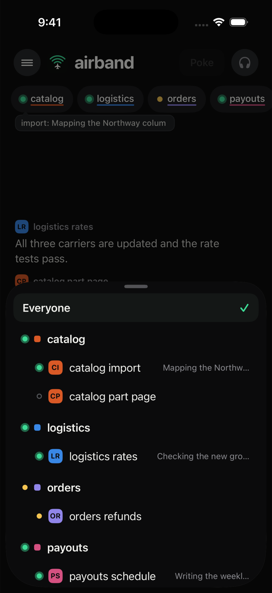

<p align="center"></p>

<h1 align="center">airband</h1>

<p align="center"><b>Squad comms for your Claudes, Codexes and OpenCodes.</b><br>Voice channels to manage all your agent teams.</p>

<p align="center"><a href="https://airband.dev">airband.dev</a> · <a href="https://airband.dev/architecture">How it works</a></p>

<p align="center">
  
  &nbsp;&nbsp;
  
</p>

**Your agent is waiting on you.** It asked a question at 4pm. You answer at 4:01.

**It wrote you a wall of text.** airband shows you the one question in it.

**Say your answer out loud.** It goes to the agent it's for.

**Works with Claude Code, Codex and OpenCode.** Keep using them as you do. airband runs next to them.

## What it does

- One feed for every agent on every project: what each one reported, and what each one needs from you.
- A question arrives as one sentence with its answers as buttons. Tap one, or say it.
- A report gives the news first and names what was shipped: the commit, the pull request, the build.
- Talk without naming anyone. Your words go to the agent they are about.
- Start a new agent by saying what you want: "with Fable high, find out why checkout is slow".
- Approve or refuse a permission prompt from your phone.
- See each team's state at a glance, and what each agent is doing right now.
- An agent long at work gets a one-line note when it does something you would look for.
- Pictures an agent sends you come with its message. Keys and tokens in a message are masked.
- Several Claude accounts: see how much of each is used, and switch every running session with one tap.
- Read aloud when you can't look, with the speaker button beside the microphone.

## How it works

A small program, airband, runs on your computer next to your agents. It hears from them through
the ways each coding tool already has of reporting, decides what is worth your attention, and cuts it to a
line. Your phone pairs with it.

Messages between the two are end-to-end encrypted. On the same network the phone talks to your computer
directly. Anywhere else it goes through airband's relay, which cannot read them. You can turn the relay off
and pair the phone directly with your computer.

It is one Rust program and uses about 6 MB of memory.

## Install

You need a Mac or Linux computer with Claude Code, Codex or OpenCode, and an iPhone. With [Homebrew](https://brew.sh), on macOS or Linux:

```sh
brew install lionpal/airband/airband && airband start
```

`airband start` connects the coding tools it finds, starts airband at login (macOS) and shows a QR code for your phone's
camera. What writes the summaries, what speaks and what listens are chosen in the app, on first run and later
under Settings.

Listening and the voice are the phone's: a model that runs on it, or a service it reaches with a key you
enter in the app. Nothing about either is set on the computer. What writes the summaries can also be chosen
at the computer, with `airband setup`, which tries the choice with a real call. One of the choices for
summaries is Alibaba Qwen 3.5 4B, which airband downloads (2.7 GB) and runs on the computer itself, so no
message leaves it. Run `airband setup` again to change it.

Then start your coding agent the way you always do. Each session shows up in the app under its project.
In Codex, type `/hooks` once and trust airband's hooks.

```sh
airband pair [name]     # pair another phone
airband relay off       # no relay: the phone reaches this computer on its network or over Tailscale
airband relay on        # airband's relay again (or `airband relay <url>` for your own)
airband lan off         # never answer the phone on the local network
airband install         # restart airband; run it after `brew upgrade airband`
airband uninstall       # run it before `brew uninstall airband`
```

Pair again after changing the relay. Without one there are no notifications: they need the relay to reach
Apple.

Or build it yourself, with Rust:

```sh
git clone https://github.com/lionpal/airband.git && cd airband
cargo build --release -p airband-cli
target/release/airband setup     # copies the binary to ~/.airband/bin first
```

The iPhone app is in TestFlight. Join the waitlist at [airband.dev](https://airband.dev), or build it yourself
with `scripts/build-apple.sh` and Xcode.

## Keys

Each key you give is kept once, under a name, and goes only to the provider it is for.

```sh
airband keys                          # every key by name and what uses it, never its value
airband keys add <provider>           # paste its key (one per provider); choose what uses it with airband setup
airband keys remove <name>
```

Keys are never written in `~/.airband/config.json`. On a Mac, a build signed with a developer certificate
(`scripts/sign-mac.sh`) keeps them in your login keychain. Everywhere else (Linux, Windows, and an unsigned
build such as the one Homebrew installs) they are in `~/.airband/keys.sealed`, encrypted with a key made from
that machine's own id, so a copy of the folder on another machine or in a backup opens nothing.

## From the terminal

```sh
airband status                 # who is on, and what is waiting on you
airband feed                   # the feed, in a terminal
airband send "ship it"         # say something to your agents
airband accounts               # your Claude accounts and how much of each is used
airband quick add "Make no mistakes"   # add a one-tap message
```

## Other agents

Claude Code, Codex and OpenCode work out of the box. Anything else that can run a command can join with one line:

```sh
airband report --id "$SESSION" --harness codex --terminal tmux --pane "$TMUX_PANE" said "$LAST_MESSAGE"
```

A deeper integration is one file. See [ARCHITECTURE.md](ARCHITECTURE.md).

## More

- [ARCHITECTURE.md](ARCHITECTURE.md): what each part owns, and where a new thing goes.
- [docs/protocols.md](docs/protocols.md): the three protocols, in full.
- [docs/state.md](docs/state.md): what has been tried and what has not.

## License

[Apache 2.0](LICENSE). The name "airband" and its logo are not part of the license.

---

airband is not affiliated with Anthropic. Claude is a trademark of Anthropic.
