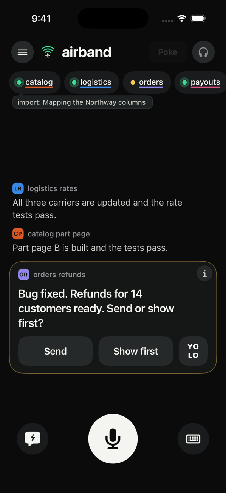

<p align="center"></p>

<h1 align="center">airband</h1>

<p align="center"><b>Squad comms for your Claudes.</b><br>Voice channels to manage all your agent teams.</p>

<p align="center"><a href="https://airband.dev">airband.dev</a></p>

<p align="center">
  
  &nbsp;&nbsp;
  
</p>

**The slowest part of your agents is you.** It asked at 4pm. Answer at 4:01, not the next morning.

**It dumped a wall of text on you.** airband shows you the question buried in it.

**Say it to the room.** Answer out loud. It reaches the right agent.

**Keep the Claude Code you already run.** airband sits on top of it.

## What it does

- One feed for every agent on every project: what each one reported, and what each one needs from you.
- A question arrives as one sentence with its answers as buttons. Tap one, or say it.
- Talk without naming anyone. Your words go to the agent they are about.
- Start a new agent by saying what you want: "with Fable high, find out why checkout is slow".
- Approve or refuse a permission prompt from your phone.
- See each team's state at a glance, and what each agent is doing right now.
- Screenshots your agents take come with their messages.
- Several Claude accounts: see how much of each is used, and switch every running session with one tap.
- Read aloud when you can't look, with the headset button.

## How it works

A small program, the tower, runs on your computer next to your agents. It hears from them through Claude
Code's hooks, decides what is worth your attention, and cuts it to a line. Your phone pairs with the tower.

Messages between the two are end-to-end encrypted. They pass through a relay that sees only sealed bytes, or
you can skip the relay and pair your phone straight to your computer over your own network.

The tower is one Rust program and uses about 6 MB of memory.

## Install

You need Claude Code. With [Homebrew](https://brew.sh), on macOS or Linux:

```sh
brew install airband-dev/airband/airband
airband install     # hooks Claude Code up and starts the tower at login (macOS)
airband pair        # shows a QR code: point your phone's camera at it
```

`airband install` is what starts the tower. There is no `brew services` entry, so the tower cannot be started
twice. After `brew upgrade airband`, run `airband install` again to restart the tower on the new version. Before
`brew uninstall airband`, run `airband uninstall`.

Or build it yourself. You need Rust.

```sh
git clone https://github.com/airband-dev/airband.git && cd airband
cargo build --release -p airband-cli
target/release/airband install     # copies the binary to ~/.airband/bin, then the same as above
airband pair
```

Then start Claude Code the way you always do. Each session shows up in the app under its project.

The iPhone app is in TestFlight. Join the waitlist at [airband.dev](https://airband.dev), or build it yourself
with `scripts/build-apple.sh` and Xcode.

From the terminal:

```sh
airband status                 # who is on, and what is waiting on you
airband feed                   # the feed, in a terminal
airband send "ship it"         # say something to your agents
airband accounts               # your Claude accounts and how much of each is used
airband model gemini           # read and route with Gemini and your own key, in place of Claude Code
airband quick add "Make no mistakes"   # add a one-tap message
```

## Other agents

Claude Code works out of the box. Anything else that can run a command can join with one line:

```sh
airband report --id "$SESSION" --harness codex --tmux "$TMUX_PANE" said "$LAST_MESSAGE"
```

A deeper integration is one file. See [ARCHITECTURE.md](ARCHITECTURE.md).

## More

- [ARCHITECTURE.md](ARCHITECTURE.md): what each part owns, and where a new thing goes.
- [docs/protocols.md](docs/protocols.md): the three protocols, in full.
- [docs/state.md](docs/state.md): what has been tried and what has not.

## License

[Apache 2.0](LICENSE). The name "airband" and its logo are not part of the license.

---

airband is not affiliated with Anthropic. Claude is a trademark of Anthropic.
